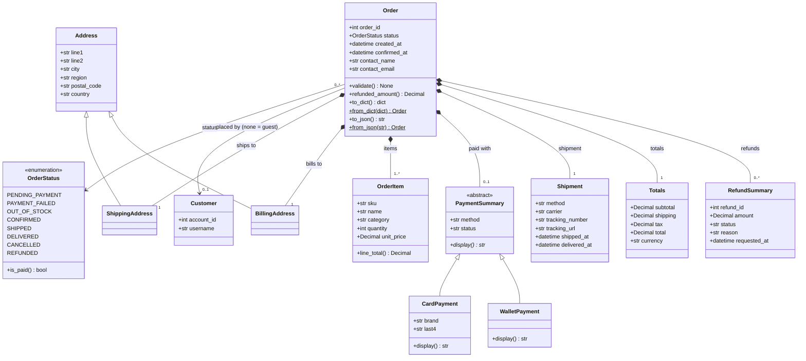

# Order: UML class diagram

This diagram matches the dataclasses in `order_model.py`. GitHub renders the Mermaid source below, and `order_uml.png` is the same diagram as an image for the report.

## How each class maps to PostgreSQL

| Class | Relational (authoritative) | JSONB (`order_document.doc`) |
|---|---|---|
| `Order` | `orders` row | the whole document |
| `OrderStatus` | `orders.status` + `orders_status_valid` CHECK | `"status"` |
| `Customer` (association) | `orders.account_id` → `accounts` | `"customer": {account_id, username}` or `null` for a guest |
| `ShippingAddress` / `BillingAddress` (inheritance) | `orders.ship_*` / `orders.bill_*` snapshot columns | `"shipping_address"` / `"billing_address"`, with `"kind"` naming the subclass |
| `OrderItem` (composition, 1..*) | `order_items` rows (FK `ON DELETE CASCADE`) joined to `products`, `categories` | `"items": [ ... ]` array |
| `PaymentSummary` → `CardPayment` / `WalletPayment` (inheritance) | latest `payments` row; card vs wallet enforced by `payments_card_fields` CHECK | `"payment"`, with `"type": "card"` or `"wallet"` as the subclass marker |
| `Shipment` | `orders.shipping_method`, `carrier_id` → `carriers`, `tracking_number`, `shipped_at`, `delivered_at` | `"shipment"` |
| `Totals` | `orders.subtotal`, `shipping_cost`, `tax_amount`, `total_amount` | `"totals"` |
| `RefundSummary` (composition, 0..*) | `refunds` rows | `"refunds": [ ... ]` array |

There are two ways to store a subclass:
- **Relational:** a discriminator column guarded by a CHECK constraint (`payments.method_type` plus `payments_card_fields`).
- **JSONB:** a discriminator key (`"type"` or `"kind"`), which `PaymentSummary.from_dict()` and `Address.from_dict()` use to build the right subclass.

Composition parts never outlive the order:
- **Relational:** `order_items` cascade on delete.
- **JSONB:** the parts are embedded inside the order's own document.
