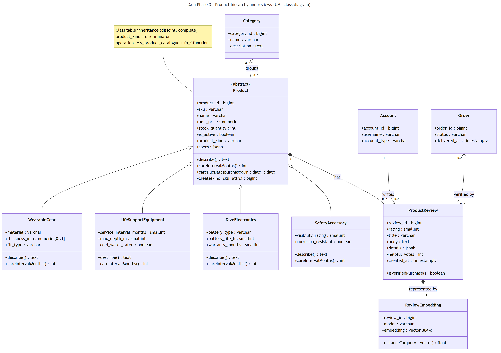
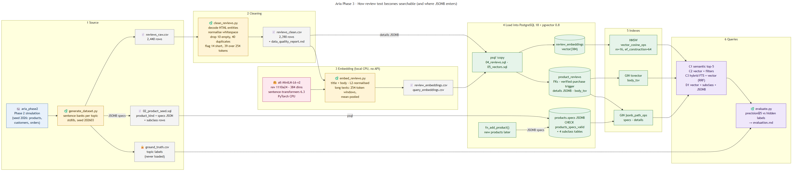

# Aria Phase 3 Technical Report: Object-oriented, JSONB and vector data in PostgreSQL

Course project, Phase 3 · Team Aria · {{DATE}} · All data is synthetic.

## 1. Overview and environment

Aria sells diving and watersports gear. In this phase we extended the Phase 2 database (`aria_phase2`) in three directions:
- the product catalogue becomes an object-oriented class hierarchy
- the attributes that differ from product to product move into JSONB
- 2,390 customer reviews become searchable by meaning with pgvector

A single query then combines all three to answer a realistic customer question. Every number in this report was captured by our scripts into `Query_Results/` and can be regenerated with `Embeddings/run_pipeline.py --all`.

| Component | Version / detail |
|---|---|
| Database server | {{SERVER}} (Docker image `pgvector/pgvector:pg18` on Windows 11; the same scripts run on the EDB Windows install, which also ships pgvector) |
| pgvector | {{PGVECTOR}} |
| Clients | `psql` 18 (scripts and captured output), pgAdmin 4 (browsing), VS Code |
| Embedding model | `sentence-transformers/all-MiniLM-L6-v2`, revision `1110a24`, 384 dimensions, 256-token input limit |
| Where it ran | locally on the laptop CPU (PyTorch 2.14 CPU build, sentence-transformers 6.3, Python 3.10); no paid service or API key |
| Text data | 2,440 raw → 2,390 clean synthetic reviews from our own generator (`generate_dataset.py`), written with the help of Claude Code. Released with the repository; no third-party licence applies. |

## 2. Design summary

The full design plan is in `Design_Plan/` (1-2 pages). In short:

- **Hierarchy.** We use **class table inheritance**:
  - The abstract `Product` keeps its shared columns in the existing `products` table.
  - `WearableGear`, `LifeSupportEquipment`, `DiveElectronics` and `SafetyAccessory` each get a table that holds only their own attributes. Each subclass table's primary key is also a foreign key to `products`.
  - We rejected single-table inheritance (about 11 mostly-NULL columns) and concrete tables, which would break the Phase 2 foreign keys from `order_items`, `inventory_movements` and `refunds`.
- **JSONB.** These attributes have keys that vary per product or review, so they live in JSONB:
  - `products.specs`: `sizes[]` (array of objects), `features{}`, `certifications[]`, `compatible_with[]`
  - `product_reviews.details`: sub-ratings and the optional `dive_context{}`

  Anything filtered, joined or constrained on every row stays relational.
- **Vectors.** The review title and body are embedded with MiniLM, compared by **cosine distance**, and indexed with **HNSW** (`vector_cosine_ops`).
- **Authoritative data.** The tables are authoritative. The view, the `tsvector` column and the embeddings are derived and can be rebuilt.





## 3. Data review

**What changes in Phase 2:**
- `products` gains `product_kind VARCHAR(20)` (the discriminator) and `specs JSONB`.
- Four subclass tables are added. Each has a `BIGINT` primary key that is also a composite foreign key `(product_id, product_kind)` to `products`.
- `product_reviews` is added, with `BIGINT` foreign keys to `products`, `accounts` and (optionally) `orders`.
- `review_embeddings` is added, linked 1:1 to reviews by `review_id`.

No Phase 2 column is changed or removed.

**Quality of the text** (`Embeddings/data_quality_report.md`):
{{QUALITY_TABLE}}

**Decisions:**
- Duplicates keep the earliest `review_id`. `UNIQUE (account_id, product_id)` blocks new duplicates in the database.
- Empty bodies are dropped.
- Very short bodies are kept. Their ratings are real, and they simply rank low in semantic search.
- No text is truncated. Embedding inputs average {{AVG_TOKENS}} tokens, and the 39 reviews over the 254-token limit are embedded in overlapping windows whose vectors are averaged.
- Generated text has no PII risk. Reviewers are the Phase 2 seed customers, and the 648 verified reviews point at real delivered orders. The trigger `fn_check_verified_purchase` re-checks this when the data is loaded.

## 4. Results

### Part A: inheritance, polymorphism, encapsulation (`A1_hierarchy_demo.sql`)

- **Inheritance.** `products` has 14 columns. Each subclass table has only its own 2-3 attributes plus the inherited key.
- **Polymorphism.** One query over `v_product_catalogue` returns a different `kind_detail` and `care_interval_months` per subclass:
  - a regulator: "service every 12 months, rated to 40 m"
  - a computer: "rechargeable li ion battery, 60 h, 24-month warranty"
  - a mask: a 36-month strap and seal check

  `fn_care_due_date()` uses that per-subclass rule to count, for each kind, the items sold that need care before the end of 2026.
- **Encapsulation.** Under the role `aria_catalogue_app`, reading `products` directly fails with *permission denied*. The same role can still read the view and call `fn_add_product()`, which writes the product and its subclass row in one transaction.
- **Rules the database rejects** (all expected errors):
  - a mask inserted as electronics (composite FK)
  - a product switching subclass (FK)
  - a product without a subclass row (deferred constraint trigger, at COMMIT)
  - a "verified" review on someone else's order (trigger)
  - invalid specs JSON (CHECK, in B1)

### Part B: JSONB (`B1_jsonb_queries.sql`)

| ID | Statement | Result |
|---|---|---|
| J1 | containment: `specs @> '{"features":{"nitrox":true}}'` | 20 nitrox-capable computers |
| J2 | JSON path: `specs @? '$.sizes[*] ? (@.available == false)'` and `jsonb_path_query_array` | products with an unavailable size, and which sizes |
| J3 | `jsonb_to_recordset(specs->'compatible_with')` joined to `products` on SKU | what REG-001 fits, with price and live stock |
| J4 | `jsonb_set` on `{sizes,2,available}` and `{features,max_o2_pct}` | nested values changed, inside `BEGIN … ROLLBACK` |

**EXPLAIN for J1:**

```
{{J1_PLAN}}
```

The planner did **not** use the GIN index for J1, and that is the right choice:
- `products` is only {{PRODUCTS_PAGES}} pages ({{PRODUCTS_SIZE}}), and the query returns 20 of 200 rows (10%).
- Reading every page sequentially (estimated cost {{J1_SEQ_COST}}) is cheaper than a bitmap index scan plus heap visits (cost {{J1_GIN_COST}}).

Two runs show that the index works when it pays off:
- With `enable_seqscan = off`, the same query uses `Bitmap Index Scan on products_specs_gin`.
- On the larger `product_reviews` table, a selective containment (`details @> '{"dive_context":{"site":"Les Escoumins"}}'`, 82 of 2,390 rows) uses `reviews_details_gin` without any hints.

One lesson: right after a bulk load the plan flipped between runs. Running `VACUUM ANALYZE` after loading (fresh statistics, an empty GIN pending list) made the plans reproducible.

### Part C: vector search

**Evaluation** (`Query_Results/evaluation.md`; relevance = right topic, the sentiment the user asked about, and the product type they asked about):

{{EVAL_TABLE}}

How relevance was decided: the generator labels every review's topic sentences (for example `fogging:neg`). The labels are kept in `eval/ground_truth.csv`, which is never loaded into the database. We spot-checked the marks by reading the reviews.

Mean precision@5 over the six searches is **{{MEAN_P5}}**, but **{{MEAN_TOPIC}}** of the results are on the right topic. MiniLM finds the topic reliably even without shared keywords: S1 "steaming up" returns "condensation builds up inside the glass". It fails in two predictable ways:
- **Sentiment and negation.** It barely separates "battery dies after a couple of dives" from "battery lasts a week-long trip" (S4), or "no free flow even in 4 degree water" from "it free flowed" (F1). Both pairs share almost all their meaning-bearing words.
- **Product names.** S5 "easy to pack" pulls in products *named* Compact, Travel or Expedition whose reviews never mention packing.

**Vector + relational/JSONB filter (C2).** The question "regulator started free flowing in icy water" is restricted to `product_kind = 'LIFE_SUPPORT'` and `details @? '$.dive_context.water_temp_c ? (@ <= 8)'`. It returns 5 rows. The plan shows that the filters leave only {{C2_CANDIDATES}} candidate rows: a Hash Join of a Seq Scan on reviews with the product-kind index, then a top-N heapsort on the exact distance ({{C2_TIME}} ms). The planner skipped HNSW because sorting about 100 rows exactly is cheaper than walking the graph, and the answer is exact.

Forcing the "HNSW first, filter after" plan exposes the classic risk. HNSW returns only `ef_search` = 40 candidates. When the filter rejects them all (the same question restricted to ACCESSORY products), the query silently returns **{{C2_WITHOUT}} rows**. With pgvector 0.8's `hnsw.iterative_scan = relaxed_order` it returns **{{C2_WITH}}**, so we enable that setting for filtered searches (D1).

**Hybrid full-text + vector (C3).** "What did divers think of the gear they used at Whytecliff Park" is a question where the exact words matter. To the embedding model, Whytecliff, Porteau Cove and Ogden Point are all "cold BC shore dive". We fuse the top 50 of each method with Reciprocal Rank Fusion (score = Σ 1/(60 + rank)).

{{HYBRID_TABLE}}

**With and without the index (C4)**, search S4, top 10:
- HNSW and the exact scan return **{{C4_OVERLAP}}/10** of the same reviews, in the same order.
- Over all nine test queries, recall@10 against the exact scan rises with `ef_search`: {{RECALL_LINE}}.

### Part D: one query that combines everything (`D1_combined_query.sql`)

> *"I dive cold water in BC and I'm buying a nitrox-capable dive computer with at least a two-year warranty. What are other divers saying about the battery draining fast in the cold?"*

The query combines three conditions:
- **vector:** distance to "battery drains fast when diving in cold water"
- **hierarchy:** `v.product_kind = 'ELECTRONICS' AND v.warranty_months >= 24` (`warranty_months` exists only on the `DiveElectronics` subclass)
- **JSONB:** `v.specs @> '{"features": {"nitrox": true}}'`

{{D1_TABLE}}

The filters narrow 200 products to 18 qualifying computers and their 182 reviews. Here the planner *does* use the GIN index: it combines `products_kind_idx` and `products_specs_gin` with a BitmapAnd, then sorts the 182 candidates by exact distance ({{D1_TIME}} ms). Three of the five answers are battery complaints from cold BC dives, which is exactly what the customer asked for. The other two discuss battery life favourably, the same sentiment limit as S4.

## 5. Performance

{{PERF_TABLE}}

At 2,390 rows every method takes about a millisecond, so the index barely matters. That is why C5 rebuilds the same table at **100,000 vectors** (real embeddings plus noise, so the data clusters like real text):
- With HNSW the query takes {{C5_HNSW}} ms; the exact parallel scan takes {{C5_EXACT}} ms, about {{C5_SPEEDUP}}× slower.
- The cost is a {{C5_INDEX}} index (bigger than the {{C5_TABLE}} table) and a {{C5_BUILD}} s single-threaded build (`maintenance_work_mem` = 512 MB).

Exact scans grow linearly with rows, while HNSW grows roughly logarithmically. At Aria's target of 1 M transactions a month, reviews will reach the 100k-1M range within a few years, so the index is needed. Its memory should be planned for: about 2 kB per 384-d vector, counting the heap and the index.

**When each technique would be the wrong choice:**
- **JSONB** is wrong for attributes that every row has or that are filtered, joined or summed constantly: price, stock, kind, warranty. JSONB has no per-key statistics (the planner guesses selectivity), no foreign keys, weaker typing, and its updates rewrite the whole document.
- **An OO hierarchy** is wrong when subclasses differ only in data, not in rules or behaviour. A category column plus JSONB is simpler. It is also costly when there are many subclasses, because every polymorphic read joins every subclass table.
- **Vector search** is wrong when the user needs exact matches (SKUs, order numbers, place names: see C3), negation or sentiment (S4, F1), or numeric conditions (water temperature ≤ 8 °C, which belongs in a WHERE clause). It is also not worth an index at a few thousand rows.

## 6. Challenges and how we solved them

- **Making search evaluation honest with synthetic text.** Random template text would make every search trivially perfect or meaningless. We wrote paraphrase banks per topic that avoid the query keywords, kept the topic labels *out* of the database, and defined relevance (topic + sentiment + product type) before running the searches.
- **Text longer than the model limit.** The tokenizer showed that 39 reviews exceed 254 tokens. Instead of silent truncation, `embed_reviews.py` embeds overlapping windows and averages them.
- **Unstable EXPLAIN plans.** The GIN plans differed between runs. The cause was stale statistics and the GIN pending list right after bulk loading, fixed with `VACUUM ANALYZE` in the load scripts.
- **Filtered vector search returning too few rows.** HNSW post-filtering returned 0 of 5 rows. We fixed it with `hnsw.iterative_scan` and documented when the planner prefers an exact pre-filter.
- **Choosing a fair exact-words test.** Our first hybrid test ("ZHL-16C") was already 5/5 with vectors alone, because the rare token is distinctive. A place name, where nearby sites look alike to the model, showed the real weakness.
- **Reproducibility.** The generator, cleaning and embeddings are deterministic: rerunning the pipeline reproduced all CSVs byte-for-byte, including the 9 MB of vectors. The model revision is pinned, and `.gitattributes` forces LF endings so `generate_dataset.py --check` works on Windows checkouts.
- **Secrets.** No passwords are in the repository. Connections use `PGPASSWORD` or a pgpass file, and the Phase 2 rules apply.

## 7. Individual contributions

| Member | Role | Specific contributions this phase |
|---|---|---|
| Brayden Nickel | Lead developer: data pipeline, database design, evaluation | Designed the class hierarchy and the JSONB/relational split. Wrote the data generator, cleaning and embedding scripts, and loaded the embeddings. Wrote the hierarchy, JSONB, vector, hybrid and combined queries. Ran the evaluation and the performance tests. Wrote the diagrams, design plan, report and README. |
| Ethan | Developer: RAG chatbot integration | Reviewed the Phase 3 schema against the RAG chatbot (`rag` branch) that will use review search, and tested the setup scripts. *(to be confirmed by Ethan)* |
|  |  |  |
|  |  |  |
